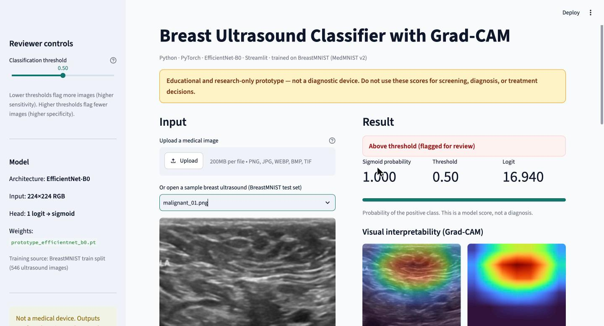
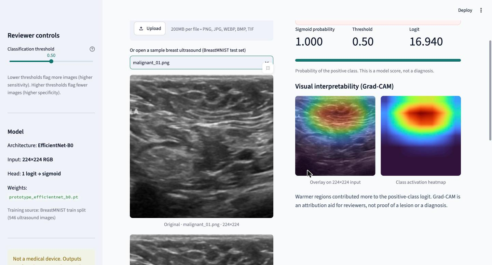

# Breast Cancer Detection AI

[](https://mohsen-fekri.github.io/breast-cancer-detection-ai/)


I trained an EfficientNet-B0 to tell malignant breast ultrasound scans apart from normal and benign ones, and added Grad-CAM so you can see which part of the image the model was looking at. It's trained on BreastMNIST (part of MedMNIST v2), which comes from the public BUSI breast ultrasound dataset.

**Live demo:** https://mohsen-fekri.github.io/breast-cancer-detection-ai/

Pick one of the sample scans or upload your own. The model runs in your browser, so nothing gets uploaded anywhere.

This is a student research project, not a medical device. Please don't use it to make decisions about real patients ([DISCLAIMER.md](DISCLAIMER.md)).



## Results

I kept the official test split (156 images) aside and only scored it once, after training was finished.

| Metric | Test set |
| --- | ---: |
| ROC-AUC | 0.916 |
| Accuracy | 0.872 |
| Sensitivity (malignant caught) | 0.857 |
| Specificity | 0.877 |
| Precision | 0.720 |
| F1 | 0.783 |

These are at the default 0.5 threshold. The full output of the run is in [`evaluation/breastmnist_results.json`](evaluation/breastmnist_results.json).

## How I trained it

I started from ImageNet weights. Fine-tuning the whole network on my laptop's CPU was too slow, so I froze the early layers and only trained the last three blocks plus the classifier head. Ten epochs took about 50 minutes.

The training set is imbalanced (147 malignant vs 399 normal or benign), so I weighted the malignant class about 2.7x in the loss. For augmentation I only used horizontal flips and small rotations (up to 10 degrees). Ultrasound images always have the skin at the top, so flipping them vertically or rotating them a lot would make images that never happen in practice.

Settings: 10 epochs, Adam, learning rate 1e-3, batch size 16, seed 2026.

## Grad-CAM without gradients

The browser version runs on ONNX Runtime Web, which can't do backprop, so I couldn't port Grad-CAM directly. It turns out you don't need gradients for this model. EfficientNet ends with global average pooling and one linear layer, so the Grad-CAM channel weights are just the linear layer's weights divided by the size of the feature map. I compute the map in the forward pass and export it together with the model ([`scripts/export_onnx.py`](scripts/export_onnx.py)). Compared with the PyTorch Grad-CAM, the maps match to within about 1e-6.

Something that looks like a bug but isn't: on clearly benign scans the heatmap is empty. Grad-CAM only keeps the regions that push the score toward "malignant", and on those images nothing does.



## Running it

The Streamlit app:

```bash
python3 -m venv .venv
source .venv/bin/activate
pip install -r requirements.txt
streamlit run app.py
```

The browser demo is a single static page in `docs/`. To run it locally:

```bash
python -m http.server --directory docs
```

There's also a Dockerfile for the Streamlit app:

```bash
docker build -t breast-us-classifier .
docker run -p 8501:8501 breast-us-classifier
```

## Retraining

Download `breastmnist_224.npz` (31 MB) from [Zenodo](https://zenodo.org/records/10519652), then:

```bash
python scripts/prepare_breastmnist.py breastmnist_224.npz --output data/breastmnist

python train.py \
  --data-dir data/breastmnist/train \
  --eval-dir data/breastmnist/test \
  --augment --unfreeze-last 3 \
  --epochs 10 --batch-size 16 --lr 1e-3 --seed 2026

python -m scripts.export_onnx   # updates the browser demo
```

`train.py` works with any folder that has `negative/` and `positive/` subfolders. Without `--eval-dir` it holds out a random 20% for validation.

Tests: `python -m pytest -q`

## Limitations

- 780 images from one hospital is a small dataset. I don't know how the model does on other machines or patient groups.
- The splits are by image, not by patient. BUSI doesn't publish patient IDs, so the same patient could show up in both train and test.
- The scores aren't calibrated. A 0.99 doesn't mean a 99% chance of cancer.
- At the default threshold it misses about 1 in 7 malignant scans, which is nowhere near good enough for screening.
- Grad-CAM shows where the model looked, not whether it looked at the right thing.

## Data

BreastMNIST is released under [CC BY 4.0](https://creativecommons.org/licenses/by/4.0/).

- Yang, J., Shi, R., Wei, D. et al. MedMNIST v2: A large-scale lightweight benchmark for 2D and 3D biomedical image classification. *Scientific Data* 10, 41 (2023).
- Al-Dhabyani, W., Gomaa, M., Khaled, H., Fahmy, A. Dataset of breast ultrasound images. *Data in Brief* 28, 104863 (2020).

## Author

Mohsen Fekri, Computer Science, York University · [LinkedIn](https://www.linkedin.com/in/mohsen-fekri) · justinfe@my.yorku.ca

## License

MIT
